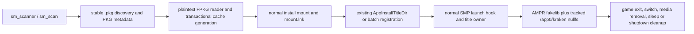

# Native debug FPKG backend: audit and architecture

Issue: [ShadowMountPlus #221](https://github.com/drakmor/ShadowMountPlus/issues/221)

This document records the Phase 0 audit and implementation progress as of
2026-11-14. It separates source facts, implemented host-testable primitives,
and remaining work. No PS5 SDK or console is present in the host environment.
A user-supplied plaintext FPKG was subsequently tested read-only; the exact
result is recorded in `docs/fpkg-test-results.md`.

## Repository and reference pins

| Project | Revision inspected | License | Notes |
| --- | --- | --- | --- |
| ShadowMountPlus | `8b1f48e086bed93e1ad53158d1103054e362f54d` (`1.7`) | GPL-3.0 | Upstream default branch is `1.7`. |
| Kraken Mount | `4b420d579bd381796d773875e36d14c9acaabf39` (`main`) | GPL-3.0-or-later | Reader, decoder, cache, index writer and launch reference. |
| ampr-emu-ng | `920e9172b6bf99bd9210361b545e2953659d1e9b` (v0.4.0 source) | GPL-3.0-or-later | Exact source revision corresponding to Kraken's bundled runtime. |
| bundled AMPR runtime | v0.4.0, SHA-256 `8320eb65c16565f42031b9d88b15a447039f0fd7e5694faf5f1cb84cafdba218` | GPL-3.0-or-later | Exact upstream artifact is under `vendor/ampr-emu-ng-v0.4.0/`, embedded in the payload, and installed to a private runtime directory only when no user runtime is present. |
| ps5-dump-forge | `8a3c7d3e4bfeac3b4ddf8e9ff020e819ae8ff1cd` (`main`) | GPL-3.0 | Its Rust tests generate temporary plaintext FPKGs from synthetic files; no game content or fixture binary is shipped. |

SMP, Kraken Mount, ampr-emu-ng and ps5-dump-forge all state GPL-3.0-compatible
terms. A native port derived from Kraken remains GPL-covered; it must preserve
attribution and the repository's GPL distribution terms. SMP adds no Rust
toolchain, Cargo runtime, Kraken daemon or proprietary game data. The pinned
AMPR NG PRX is a separate, unmodified GPL binary with its provenance and license
recorded in `licenses/AMPR-NG-NOTICE.md`.

PR #200 (`quer3q/ShadowMountPlus`, head `3663a32e56130c722ee0aa77623be5f19d5674ee`)
is still open against `1.7`, not part of the inspected SMP baseline. It proposes
recognizing/updating AMPR NG in fakelib. This branch uses its distinct
`<emulators_path>/ampr-emu-ng/libSceAmpr.sprx` storage convention but keeps the
existing SMP updater's top-level upstream AMPR target separate. Native FPKG
launch now verifies the NG identity and places that runtime last in the
SMP-owned fakelib cache, after package, backport and global libraries. A
compatible user-provided runtime there takes precedence; when that file is
missing, SMP installs its pinned v0.4.0 runtime into a private data directory.
The existing top-level updater remains separate. PS5-side loader selection
still needs console verification.
PR #206 is
also open against `1.7` (head
`3596e602f7c1c89faff53d55215fc02e89a48703`); it changes same-title process
handoff to reuse a prepared/mounted runtime before binding the replacement
process. That lifecycle ownership behavior must be reconciled before adding a
process. Same-title handoff behavior differs from this baseline and may affect
when an FPKG layer is reused. This branch reuses SMP's existing layer owner
rather than adding a second session; same-title handoff still needs PS5
lifecycle validation.
PR #215 was closed unmerged and is an unrelated Trail/docs change. The
connected GitHub account has read-only permission on upstream.

## Kraken function map

| Kraken component | SMP implementation | Behavior carried over | Remaining boundary |
| --- | --- | --- | --- |
| `crates/kraken-mount-pkg/src/pkg.rs`: FIH/CNT and package open | `sm_pkg.c`, `sm_fpkg.c` | Reuse SMP PKG metadata, then accept supported plaintext debug-FPKG layouts | Unsupported/encrypted layouts fail closed; no crypto or platform validation is bypassed |
| `outer.rs`: PFS geometry and extents | `sm_fpkg.c`, `sm_fpkg_tree.c` | Bounded outer maps and inner tree access | Bounds/unsupported geometry can differ from Kraken error classification |
| `tree.rs`: inner PFS entries and paths | `sm_fpkg_tree.c`, `sm_fpkg_image.c` | Retain validated paths, bounded reads and block mapping | Non-contiguous or unaligned AMPR mappings are rejected |
| `kraken.rs`, `decoder/{mod,huff,lz,timing}.rs` | `sm_fpkg_layout.c`, `sm_fpkg_decoder.c` | Kraken block mapping and decompression | Platform-specific runtime performance remains unmeasured |
| `src/ampr_index.rs` | `sm_fpkg_index.c` | AMPRIDX3 and AMPRPAK4 codec-2 generation | Host byte-oracle coverage is synthetic and partial |
| `src/cache.rs` | `sm_fpkg_cache.c` | Extract required loose files, generate indexes and publish cache | SMP adds immutable generations and ownership-checked cleanup for crash safety |
| `src/launch.rs` | existing `sm_fakelib.c` layer owner | Mount package parent read-only at sandbox `app0/kraken` | SMP uses its FSID-owned lifecycle cleanup instead of Kraken's standalone session |
| `register.rs` / `watcher.rs` | `sm_scan.c`, `sm_install.c`, `mount.lnk`, appdb bridge | Scan, publish, register and launch through the normal SMP lifecycle | Actual platform registration and loader acceptance require PS5 validation |

The native C reader, decoder, index writer, transactional cache, scanner path,
registration path and launch-owned sandbox layer are implemented in this branch.

Backport files outside `fakelib` and `fakelib2` are snapshotted, staged as
loose files and merged into both AMPR indexes by case-folded path. The snapshot
is rechecked before publication and at launch; a changed or removed backport
requires a new generation. Backport symlinks and special filesystem entries
are rejected because staging uses no-follow opens.
When an override differs from the package path only in letter case, SMP stages
and indexes it using the package spelling so the resulting title remains
accessible on case-sensitive filesystems. KrakenMount retains the backport's
spelling in its generated index.

KrakenMount mounts the registered title stack writable directly in `/app0`.
SMP instead mounts a per-title writable union layer above the registered stack
to keep published cache generations immutable. On generation changes SMP
copies game-created entries into a fresh layer, excludes files owned by either
generation, and retains prior layers as backups. This differs from Kraken's
in-place rebuild and may use more storage. Unsupported special entries,
including filesystem whiteouts, stop migration without deleting the previous
layer. Sandbox mount flags, copy-up and loader behavior still require PS5
verification.
The scanner creates candidates only when `fpkg_direct_mount` is enabled and the
existing PKG parser classifies a confident base package; the native reader then
rejects unsupported/non-plaintext layouts. The install worker publishes a
verified generation before passing its directory through SMP's existing
`mount_title_nullfs` → `mount.lnk` → `AppInstallTitleDir` path. At sandbox-ready,
SMP validates the generation/source snapshot, then tracks a read-only nullfs of
the original package parent at sandbox `/app0/kraken`, matching KrakenMount's
`kraken.image` resolution. Existing lifecycle cleanup owns this layer by mount
identity. The feature is enabled by default with `[fpkg] direct_mount=on`;
set it to `off` to disable this backend.

## Current SMP call path

FPKG candidates use the existing package metadata parser, then the native reader
and transactional cache. They flow through the same normal install worker and
registration path as directory-backed titles. The launch hook validates the
published generation and mounts the original package parent where AMPR NG
expects it. SMP lifecycle and mount-state code retain ownership through cleanup.

## AMPR compatibility matrix (reference source inspected)

| Source/runtime mode | Detection | Library injection | Runtime reads | FPKG backend relationship |
| --- | --- | --- | --- | --- |
| Plain folder | Existing SMP source/mount path | Existing SMP fakelib behavior; PR #200 proposes NG-specific handling | Not console-verified here | Preserve |
| ZSTD folder | Existing AMPR NG detects `ampr_zstd.index` | Existing fakelib path; NG identity/update behavior depends on PR #200 | Not console-verified here | Unchanged |
| LZ4 folder (`AMPRPAK4`) | Existing AMPR NG detects `ampr_assets.index` | Existing fakelib path; NG identity/update behavior depends on PR #200 | Not console-verified here | Unchanged |
| Plaintext debug FPKG | AMPR NG v0.4.0 `crates/ampr-sys/src/rt/pack/pkg.rs` selects `pkg` mode and reads `/app0/kraken.image` | A compatible runtime at `<emulators_path>/ampr-emu-ng/` takes precedence; otherwise SMP installs the pinned runtime in its private data directory and copies it last into the owned fakelib cache. If general fakelib is disabled, the cache contains only the required runtime. | Host resolver, bundled fallback install, identity checks and Fakelib syntax pass; codec-2 reads and PS5 launch remain unverified | Generate AMPRIDX3 and AMPRPAK4 codec-2 records; mount package parent read-only |

The v0.4.0 source was inspected at commit
`920e9172b6bf99bd9210361b545e2953659d1e9b`. Its `crates/ampr-pkg/src/manifest.rs`
validates the AMPRPAK4 header, CRCs, record sizes, offsets, page flags and codec
value 2 for pack 0; `crates/ampr-pkg/src/lib.rs` defines codec 2 as Kraken and
the full-block flag as `0x10`. The runtime package reader calls the Kraken block
decoder using worker-owned scratch memory. These source checks establish a
format target, not acceptance of a future C writer or a console launch result.

## Trust boundaries and ownership

| Operation | Existing owner / guard | FPKG-specific requirement |
| --- | --- | --- |
| Scan roots, source stability, removable media | `sm_scanner`, `sm_scan`, `sm_scan_tree` | Implemented: feature-gated `.pkg` discovery (enabled by default, explicitly disabled with `off`), stable open, metadata and FPKG validation, existing duplicate/protected-title rules. |
| PKG metadata/classification | `sm_pkg.c`, `sm_fpkg.c` | Implemented: one PKG metadata parser, then a plaintext layout reader; no decryptor or security bypass was added. |
| Cache creation and recovery | `sm_fpkg_cache.c` | Implemented: per-title lock, immutable owned generations, source snapshot, journal, active-pointer publication, recovery inspection, quarantine and ownership-checked cleanup. |
| Registration and title state | `sm_install.c`, `sm_install_queue.c`, `mount.lnk`, appdb bridge | Implemented through existing SMP path after a generation is validated. Superseded cache cleanup waits for app.db confirmation on asynchronous batch installs. Actual console return codes remain PS5-only. |
| Game launch, sandbox readiness and switching | lifecycle worker, `sm_shellcore_service.c`, `sm_fakelib.c` | Implemented: revalidate source at runtime preparation and track read-only `/app0/kraken` nullfs in the existing owner. Console mount permissions and launch acceptance remain PS5-only. |
| Fakelib and package data | `sm_fpkg_cache.c`, `sm_fakelib.c`, `sm_ampr_runtime.c` | Implemented: stage package `fakelib/` and `fakelib2/` loose, omit them from AMPR package data index, do not mutate immutable generations, and overlay the identity-checked NG runtime through SMP's versioned fakelib cache. Missing or non-NG runtime blocks FPKG launch preparation. |
| Elevated mount/appdb calls | PS5 SDK and existing SMP abstractions | Reused without changing platform security checks. Host cannot establish how a particular console firmware accepts or rejects a package. |

Inputs crossing trust boundaries include package bytes, package path components,
scan/API/UI requests, cache state files, removable media and mount-table
observations. Risks to handle include truncated headers, malformed CNT tables,
integer overflow, recursive/aliased blocks, huge inode counts, deep trees,
decompression bombs, invalid UTF-8, normalized/case-folded path collisions,
symlink swaps, corrupt ownership manifests, USB removal, power loss, process
death, duplicate title IDs, incompatible/missing AMPR, stale sandbox paths, fsid
mismatch, and active sessions. Malformed input must fail closed before writes.

## Confirmed reference risks (not exploit claims)

Evidence below is from Kraken Mount revision
`4b420d579bd381796d773875e36d14c9acaabf39`:

| Source | Confirmed behavior | Required SMP treatment |
| --- | --- | --- |
| `src/cache.rs:170-174` | `clear_build` falls back to `empty_dir` when `.built` cannot be read. | Do not port. Missing/corrupt ownership data must quarantine/defer, never authorize deletion. |
| `src/cache.rs:174-177` | `fakelib` is recursively deleted before it is recomposed. | Do not apply to an SMP cache containing unknown/game-created files. Replace only validated backend-owned files. |
| `src/cache.rs:501-520` | Cache rebuild clears old generated files before new build validation completes; failed build removes paths created during that attempt. | Use staged generation plus journal; preserve previous good generation and unknown paths. |
| `src/cache.rs:103-119` | Extract opens destination with create/truncate and creates parents by path. | Use directory-relative no-follow operations, private staging and exclusive creation. |
| `src/cache.rs:380-412` | Freshness parse defaults malformed `.done` to an empty value and reports stale. | A stale signal may schedule a safe rebuild; it must never imply cleanup ownership. |
| `src/launch.rs` session code | Kraken tracks fsids for its mount layers and sandbox path, which is a useful ownership model. | Extend SMP's own mount identity record; never unmount by path alone. |
| `src/launch.rs:837-867` | On `EBUSY`, retries every 250 ms for 10 seconds, then attempts one `MNT_FORCE` unmount and drops the session after that attempt. | SMP must retain its ownership/session-generation checks; defer and report if mount identity is ambiguous. Do not copy the forced fallback. |
| `crates/kraken-mount-pkg/src/outer.rs:1-3` | The reader explicitly says plaintext outer PFS SHA3 fields are not checked. | Do not claim integrity validation. Record the omission; assess whether verification is feasible and bounded. |
| `outer.rs:77-89` | `parse_dinodes` bounds returned nodes to one supplied block and silently clamps to fit. | Validate inode count against the format and available tables; reject unsupported geometry rather than silently truncate. |
| `outer.rs:197-223` | Indirect traversal descends by finite level but does not track repeated block aliases. | Bound depth and records, detect invalid alias/cycle patterns, and validate all extents. |

These observations describe reference implementation behavior only; whether a
particular input can exploit it is unproven.

## Host baseline and planned files

The baseline `make` cannot start because `/opt/ps5-payload-sdk/toolchain/prospero.mk`
is absent. Host tools are Apple Clang 21 and Python 3.14. Docker is unavailable.
The existing host test scripts were run on macOS; outcomes and their platform
blockers are in [fpkg-test-results.md](fpkg-test-results.md).

The bounded reader validates FIH/CNT and plaintext outer-PFS metadata, direct and
indirect maps, the Kraken layout descriptor and the bounded inner tree. It
uses the inner PFS superblock's block-size field to locate the inode table and
reads its inode records in 64 KiB pages. Synthetic 64 KiB and 256 KiB block-size
fixtures cover both layouts. It supports file reads and block mapping, then
builds AMPRIDX3 and AMPRPAK4 codec-2 records. The transactional cache selects
required loose files (`eboot*.bin`,
`sce_sys/**`, `*.prx`, `*.sprx`, and package fakelib trees), writes owned
metadata and indexes into an immutable generation, checks the source snapshot,
and atomically changes the per-title active pointer. Recovery does not delete
uncertain state; cleanup validates the ownership manifest, serializes with
title lifecycle state, quarantines first, then removes only owned entries.

Host checks for reader, index, cache, scanner and sandbox cleanup are listed in
`docs/fpkg-test-results.md`. The macOS host lacks
`/opt/ps5-payload-sdk/toolchain/prospero.mk` and PS5 kernel headers, so the full
PS5 build is delegated to the Ubuntu workflow. Workflow `43612405370` built the
payload successfully at commit `9bb1057` and uploaded a commit-specific ELF.
There is no console here; PS5 registration, mount and launch validation remain
outstanding.

## Remaining integration boundaries

The implemented path reaches existing registration and launch calls without
changing their authorization behavior. It does not bypass package signatures,
licenses, encryption, PFS signature checks or platform policy. The reader only
accepts layouts it can read as plaintext. Whether `AppInstallTitleDir` (or SMP's
existing newer-firmware bridge), title registration, sandbox nullfs, AMPR NG and
the PS5 loader accept a specific authorized debug package is a console question;
no host API can establish that result. A platform rejection must be reported
from the existing return code or mount error. Supported implementation options
are to use an already supported firmware registration bridge, install through
the platform's supported debug-package route and register its resulting title
directory with SMP, or keep the package as an SMP-managed title only where the
console's existing registration API accepts it. Adding a path that skips a
platform check is out of scope.

KrakenMount's `launch.rs` mounts the package parent read-only at sandbox
`/app0/kraken`; SMP now does the same through its tracked Fakelib layer. The
technical deviation is ownership: SMP records and cleans this mount through its
existing layer/FSID session instead of KrakenMount's standalone session and
retry loop. SMP does not force-unmount an ambiguous layer. FPKG launch requires
an AMPR NG runtime. A compatible user-provided file at
`<emulators_path>/ampr-emu-ng/libSceAmpr.sprx` takes precedence; if absent, SMP
atomically stages its pinned v0.4.0 runtime under
`/data/shadowmount/fpkg-runtime/ampr-emu-ng/`. A file at either location with
the wrong family marker is preserved and rejected. The bundled runtime SHA-256
is `8320eb65c16565f42031b9d88b15a447039f0fd7e5694faf5f1cb84cafdba218` and CI
checks it against the vendored checksum. Runtime identity checks are not
signature or license verification. PS5-side library selection and behavior
remain unverified by host tests.

## Decision record

Use a native C11/gnu11 backend in SMP rather than Rust FFI. SMP's build discovers
`src/sm_*.c` directly and already owns scanning, metadata, cache, registration,
fakelib, lifecycle and mount cleanup. Rust FFI would introduce a second toolchain
and runtime boundary without moving ownership closer to the existing code. A
second daemon would duplicate title registration, lifecycle and mount ownership.
The C backend will be a bounded library called by those existing SMP owners; it
will not include a watcher, web server or appdb implementation.
